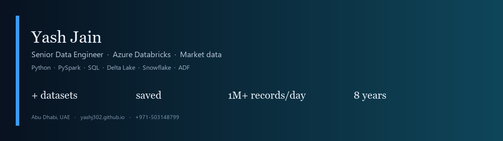

# Yash Jain

  

**Senior Data Engineer** in Abu Dhabi. I design and run production pipelines in **Python**, **PySpark**, and **SQL** on **Azure Databricks** and Delta Lake — currently market-data enablement for a premier sovereign wealth fund.

Clients across a wide mix of industries: **Nedbank**, **Air Canada**, **Camping World**, **IFFCO-Tokio**, **Disney**, **TMF**, and now a **premier sovereign wealth fund**.

[Open the portfolio](https://yashj302.github.io) · [View resume (PDF)](https://yashj302.github.io/resume.html) · [LinkedIn](https://www.linkedin.com/in/yashj302/) · [Email](mailto:Yashj302@gmail.com) · +971-503148799

---

## Impact from production work

| Outcome | Result |
| --- | --- |
| Market-data datasets enabled | **$1B+** underlying value |
| Pipeline cost after Spark / Delta tuning (Disney) | **$260K** saved |
| Overnight hotfix + compaction (Air Canada) | **95%** ingestion time saved |
| Contact-centre records processed daily | **1 million+** |
| Trade / FX document pairing accuracy | **92%** |

## What I am hired to do

- Onboard public and private market data from vendors into an enterprise lakehouse
- Design PySpark / SQL ingestion, incremental loads, upserts, and medallion (raw → curated) layers
- Keep Delta tables cheap and fast: `OPTIMIZE`, `VACUUM`, auto-compaction, deletion vectors
- Put data-quality gates and alerts in front of production consumers
- Troubleshoot production incidents on Azure Databricks, ADF, Snowflake, and Airflow

## Experience

**Intuitive.ai - Premier Sovereign Wealth Fund** — Senior Data Engineer, Market Data Ingestion · Dec 2025 – Present · Abu Dhabi  
Onboarding Bloomberg, Refinitiv, Dasseti, GS-Quant, Barclays, Alexandria Technology, Wolfe Research, and Managed Corporate Actions (S&P), Morgan-Stanley, JP-Morgan and various other vendors data into the lakehouse. Orchestrated in Stonebranch. Datasets representing $1B+ in underlying value.

**HappiestMinds · Disney** — Senior Data Engineer, Identity Consumer Data · Mar 2024 – Nov 2025  
PySpark ETL of Conviva data into Snowflake on Airflow and Azure Databricks. CCPA/GDPR purge. Account-spinoff detection. **$260K** processing-cost reduction. Delta OPTIMIZE / VACUUM / deletion vectors.

**HappiestMinds · TMF, Enate** — Senior Data Engineer, Global Payroll · Oct 2023 – Mar 2024  
Raw-to-curated ADF batch, Python data-quality framework, Databricks upserts and rejected-file handling on ADLS Delta / Parquet.

**IBM · Air Canada** — Senior Data Engineer, Contact Centre (Pod Lead) · Sep 2021 – Sep 2023  
Medallion batch and streaming on Azure Databricks. 1 million+ records/day. Overnight leak hotfix that saved 95% of ingestion time.

**IBM** — Data Scientist / Data Engineer · 2019 – 2023  
Chatbots (OpenAI, Watson), Camping World and IFFCO-Tokio delivery, Nedbank trade/FX digitization at 92% pairing accuracy, Air Canada pipeline operations.

## Stack

`Python` `PySpark` `SQL` `Azure Databricks` `Delta Lake` `Snowflake` `Azure Data Factory` `ADLS` `Azure Synapse` `Airflow` `Stonebranch` `Axway` `Git` `Azure DevOps` `Docker`

## Certifications and education

- Azure Databricks Data Engineer Associate
- Azure AI Engineer
- Azure Data Scientist
- B.Tech. Computer Science, NIIT University, 2015–2019, CGPA 7.92

---

Based in **Abu Dhabi, UAE**. Open to conversations on Databricks, lakehouse platforms, and market-data engineering.
